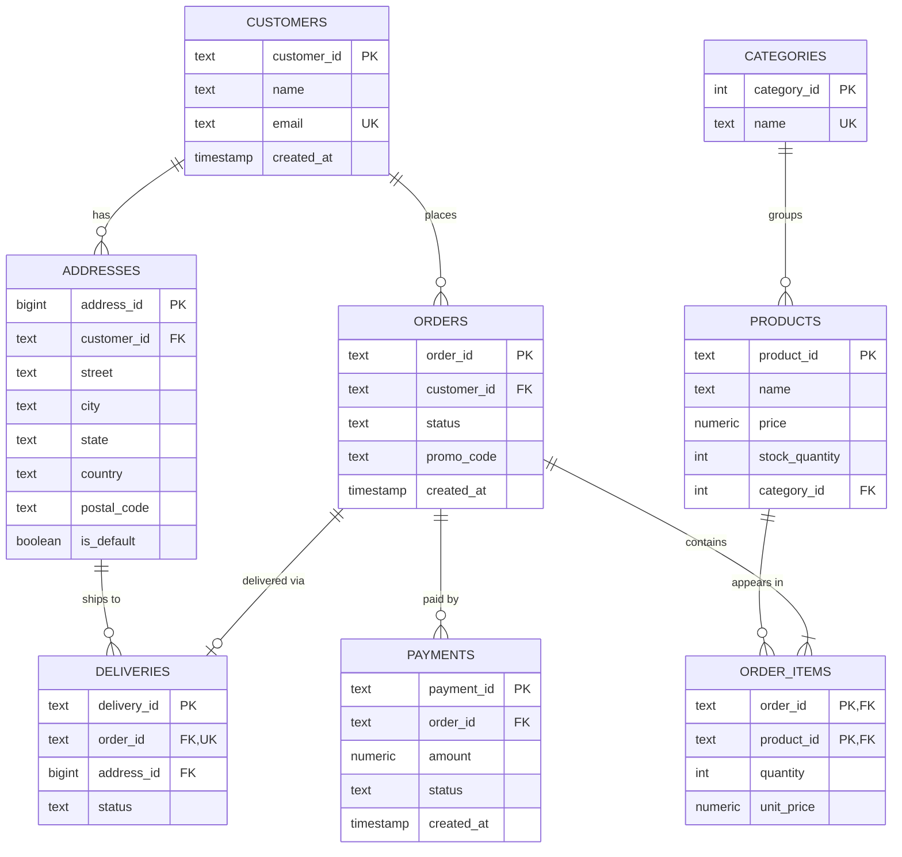

# E-commerce ERD (Week 7)

## Relationships
- customers to addresses: one-to-many
- customers to orders: one-to-many
- categories to products: one-to-many
- orders to products: **many-to-many**, resolved by `order_items`
- orders to payments: one-to-many (retries)
- orders to deliveries: one-to-one (UNIQUE on `order_id`)
- addresses to deliveries: one-to-many