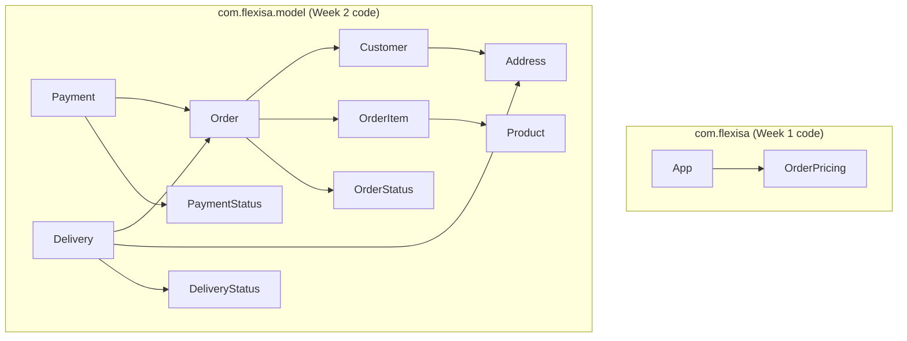

# Package Diagram

## Before (Week 2 structure)

### Observations (problems this structure has)

- Everything outside `model` sits in one root package with no layering.
- The Week 1 pricing code (`OrderPricing`) and the Week 2 model are not connected.
  `Order.calculateTotal()` ignores discounts, delivery fee and tax.
- `OrderPricing` mixes input validation with every pricing rule (low cohesion).
- `App.main` reads input, validates, calculates and prints in one method.
- Discount thresholds, rates and promo codes are hard-coded inside methods,
  so adding a new discount means editing existing code.
- The same blank/null/positive checks are repeated across model classes.