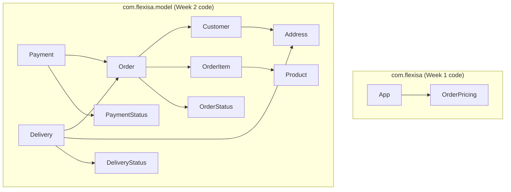
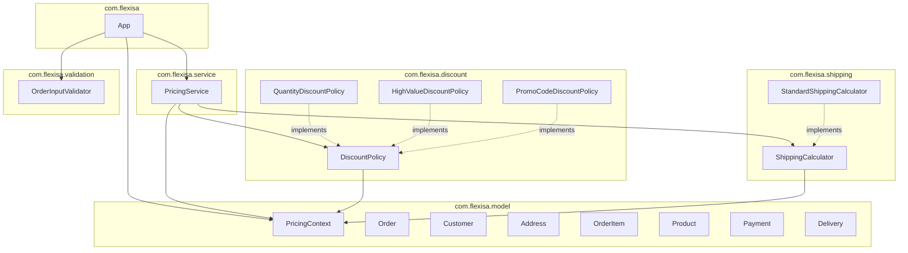

# Package Diagram

## Before (Week 2 structure)

### Observations (problems this structure has)

- Everything outside `model` sits in one root package with no layering.
- The Week 1 pricing code (`OrderPricing`) and the Week 2 model are not connected.
  `Order.calculateTotal()` ignores discounts, delivery fee and tax.
- `OrderPricing` mixes input validation with every pricing rule (low cohesion).
- `App.main` reads input, validates, calculates and prints in one method.
- Discount thresholds, rates and promo codes are hard-coded inside methods,
  so adding a new discount means editing existing code.
- The same blank/null/positive checks are repeated across model classes.

## After (Week 3 structure)

The status enums (`OrderStatus`, `PaymentStatus`, `DeliveryStatus`) and the
internal relationships between the Week 2 model classes are unchanged, so they
are left out of this diagram to keep it readable.

### What changed

- `OrderPricing` was removed. Its responsibilities are now split across
  `PricingService` (calculations), `OrderInputValidator` (validation) and the
  discount and shipping classes (rules).
- `PricingService` depends on the `DiscountPolicy` and `ShippingCalculator`
  interfaces, not on concrete classes. Only `App` knows which implementations
  are used.
- `PricingContext` lives in `model`, so dependencies run one way
  (`service` to `discount`/`shipping` to `model`) and the cycle is gone.
- `App.main` was split into small methods for reading input, creating the
  service and printing the summary.

### Known gaps that remain

- The Week 2 model (`Order`, `Payment`) is still not connected to
  `PricingService`. `Order.calculateTotal()` ignores discounts, delivery and tax.
- A `NaN` price still passes validation, as it did in Week 1.